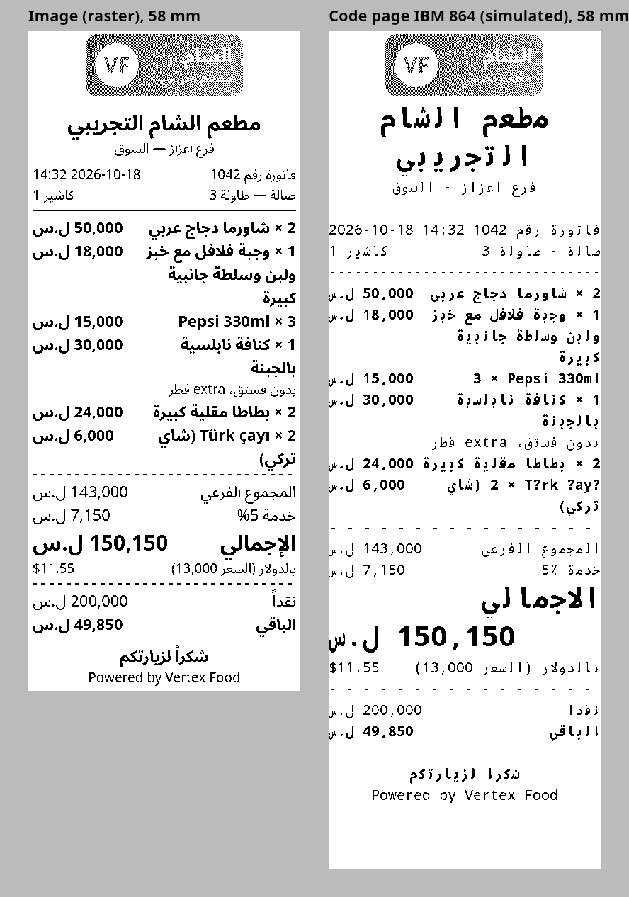
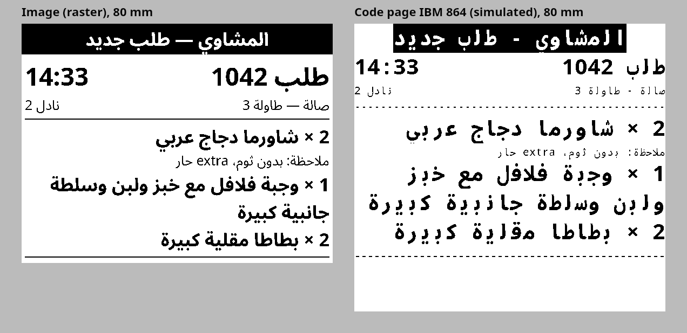

# Spike B — Printing (Arabic receipts and kitchen tickets on ESC/POS printers)

Date: 2026-10-18 · Branch: `spike/printing` · Code: `spikes/printing/` (throwaway) · Decision: [ADR 0023](../decisions/0023-printing-confirmed-by-spike-b.md) (proposed), which confirms and amends the printing part of [ADR 0008](../decisions/0008-offline-first-restaurant-and-lan-hub.md)

## Verdict

**Print images, not the code page.** The restaurant app renders each receipt and kitchen ticket to a 1-bit image in Electron's main process and sends it as ESC/POS raster. The rendering uses Skia with a bundled Arabic font and needs no window. Arabic joins correctly and lines read right to left, with Latin item names, Turkish letters, prices, dates and dollar amounts in their right places. A receipt renders in 5 to 7 ms and a kitchen ticket in 2 to 3 ms, so the printer's mechanism sets the speed: about 0.9 s for an 80 mm receipt at 150 mm/s.

The printer's Arabic code page (IBM 864) works but prints worse:
- 18 % of the receipt's characters and 28 % of the ticket's come out in the wrong letter form;
- it has no "إ" at all, and no Turkish letters;
- the code page's table number differs between makers.

Its only gain is size (7.5 KB instead of 70 KB), which does not matter on USB or Ethernet.

Every check passes in Node 24.21 (37) and in Electron 44.4.3's main process (41, with the Chromium comparison), in seven consecutive runs (four in Node, three in Electron). No real printer was available: everything ran against a printer emulator. The real-hardware checks are listed below for Q8.

What the spike settles beyond ADR 0008 (ADR 0023):
- **One renderer:** a document of blocks, rendered to a 1-bit page with Skia.
- **Network transport:** ask the status first, send the job, then wait for an answer that comes back only after printing.
- **USB transport:** the Windows print queue with RAW jobs.
- **A durable print queue:** at-least-once printing; a possible duplicate prints as "نسخة معادة"; no second drawer kick.
- **Kitchen printers on the network:** after a hub failover, the new hub must still reach them.

## What was built

| Part | Choice | Version |
|---|---|---|
| Document | A list of blocks: logo, text (size, bold, alignment), row (label on the right, amount on the left), inverted banner, rule, feed. One receipt and one kitchen ticket, built from synthetic fixtures with integer minor units | — |
| Image path | Skia through `@napi-rs/canvas` (an N-API addon that also loads in Electron's main process): HarfBuzz shaping, the bidi algorithm, `direction = 'rtl'`. Words wrap to the paper width. The page is thresholded to 1 bit and sent as `GS v 0` raster in bands of 256 rows | `@napi-rs/canvas` 1.0.10 |
| Font | Noto Sans Arabic (SIL Open Font License), Arabic, Latin and Latin Extended subsets, regular and bold, bundled. Never the fonts of the Windows install | `@fontsource/noto-sans-arabic` 5.3.0 |
| Logo | A synthetic colour logo with a gradient (a stand-in for a tenant's upload), scaled to 60 % of the paper width and dithered (Floyd–Steinberg) once per width | — |
| Code-page path | A JavaScript shaper (contextual forms, lam-alef ligatures, harakat dropped) and a small bidi reordering for a printer that prints left to right. Encoding is IBM 864 with substitutions for missing forms. Fixed columns of 32 or 48 characters, double size for headings | `iconv-lite` 0.7.3 |
| Chromium path (comparison only) | The same document as HTML in an offscreen `BrowserWindow`, frames from the `paint` event, thresholded the same way | `electron` 44.4.3 |
| ESC/POS | `ESC @`, `ESC a`, `ESC E`, `GS !`, `ESC t`, `GS v 0`, `GS B`, `GS V 66`, drawer `ESC p 0 25 250`, status `DLE EOT 1/2/4`, `GS r 1` | — |
| Network transport | Raw TCP (port 9100 style), with timeouts on connect (2 s), on the status answer (1.5 s) and on printing. Errors are typed: `unreachable`, `no_answer`, `not_ready`, `cut_off`, `not_confirmed` | Node `net` |
| USB transport | A Windows print queue with a RAW job: `OpenPrinterW`, `StartDocPrinterW` (datatype `RAW`), `WritePrinter`, called through FFI without a native build | `koffi` 3.3.2 |
| Print queue | One FIFO per printer. An append-only log, `fsync`ed before each send. Enqueueing is idempotent by job id. Retries back off; every failure raises an alert | — |
| Printer emulator | Raw TCP; parses the commands above and rebuilds the paper as an image. It answers status, kicks a virtual drawer and models head speed and a small input buffer. It serves one connection at a time. Faults: paper out, cover open, switched off, connection cut after N bytes, a link that accepts and never answers | — |

Fixtures are synthetic: "مطعم الشام التجريبي", prices in SYP with a USD equivalent, and one Turkish item name.

## Results

Run: `pnpm scenarios` (Node) and `pnpm scenarios:electron` (Electron), on the owner's Windows 11 PC, idle. Times are medians of 15 warm renders (5 for Chromium). The ranges cover the seven final runs.

| Area | What was shown | Result |
|---|---|---|
| Shaping and direction | Skia joins Arabic letters. The JavaScript shaper picks contextual forms and the lam-alef ligature. A code-page line is reordered for a left-to-right printer, with numbers kept in reading order | Pass |
| Rendering | Receipt and ticket at 58 mm (384 dots) and 80 mm (576 dots). Receipt length 116 to 121 mm, ticket 49 to 56 mm | Pass |
| Round trip | Each image job sent to the emulator comes out on paper identical to the rendered page, dot for dot, at both widths. The same page sent in 24-row bands prints identically. The emulator met no command it does not know | Pass |
| Printed answer | `GS r` is answered only after the head has printed the page: 0.45 s for an 80 mm ticket and 0.89 s for an 80 mm receipt at 150 mm/s; 0.67 s and 1.42 s at 58 mm at 90 mm/s | Pass |
| Drawer | A cash receipt kicks the drawer once (pin 2, 50 ms on, 500 ms off), at the start of the job so the drawer opens while the receipt prints. A kitchen ticket never kicks | Pass |
| Printer states | Paper out and cover open: the status asked before sending refuses the job, and nothing is sent. Switched off: `unreachable` in about 1 ms on loopback (2 s when no host answers). A link that accepts and never answers: `no_answer` after 0.8 s, never a hang | Pass |
| Two PCs, one printer | Two jobs at once. The printer serves one connection at a time, so the pages never interleave. The second job waited 0.9 s, so its answer timeout must cover a whole job | Pass |
| Queue, printer off | Three kitchen tickets wait. Each failed attempt raises an `unreachable` alert, and the same ticket enqueued twice is kept once. Once the printer is on, the tickets print once each, in order, unmarked, 1.6 s after power on | Pass |
| Queue, paper out | The ticket waits with a `not_ready / paperEnd` alert. When paper is loaded, it prints as a new ticket, not as a reprint | Pass |
| Queue, connection cut mid-receipt | The half page stays in the printer. The receipt prints again whole, marked "نسخة معادة", and the drawer does not open a second time | Pass |
| Queue, the app killed while sending | The queue process is killed (`TerminateProcess`) after 65 KB, then restarted. The receipt is pending as "maybe printed" and prints again whole with the reprint mark, 5.9 s after the restart on a slow (40 mm/s) printer. The drawer opened once in total | Pass |
| USB | `koffi` loads `winspool.drv` in Node and in Electron's main process; an unknown printer fails cleanly with Win32 error 1801. **No RAW job reached a real printer**: this PC has none, and the session had no administrator rights to add a test queue | Partly tested |
| Chromium (Electron only) | Chromium renders the same pages at the same width with the same quality. The offscreen window opens in 85 to 115 ms | Pass |

### Speed and size

| Document | Paper length | Skia render (median) | Chromium render (median) | Raster encode | Image job | Code-page job | Print time (model) |
|---|---|---|---|---|---|---|---|
| Receipt, 80 mm | 121 mm | 6.3 to 7.0 ms | 45 to 61 ms | 0.1 ms | 70 KB | 7.5 KB (6.3 KB is the logo) | 0.9 s at 150 mm/s |
| Receipt, 58 mm | 116 mm | 4.9 to 5.5 ms | 38 to 60 ms | 0.1 ms | 45 KB | 3.8 KB | 1.4 s at 90 mm/s |
| Kitchen ticket, 80 mm | 56 mm | 2.6 to 3.0 ms | 31 to 32 ms | < 0.1 ms | 32 KB | 0.4 KB | 0.45 s at 150 mm/s |
| Kitchen ticket, 58 mm | 49 mm | 1.7 to 1.8 ms | 19 to 28 ms | < 0.1 ms | 19 KB | 0.35 KB | 0.67 s at 90 mm/s |

The first render after start takes 13 to 15 ms (receipt). At 10 Mbit/s, a 70 KB job takes about 56 ms on the wire; USB 2.0 full speed is faster. So the print head, not the format, sets the time to paper. The size only matters for Bluetooth or serial printers, which V1 does not target.

### Image versus code page

The right-hand pages show the emulator's simulation of a code-page printer: each byte is drawn in a 12 × 24 cell with the bundled font. A real printer draws its own ROM glyphs, which are usually cruder. Chromium's rendering of the 80 mm receipt is in [`B-printing/chromium-receipt-80.png`](B-printing/chromium-receipt-80.png), next to Skia's [`B-printing/image-receipt-80.png`](B-printing/image-receipt-80.png).

| | Image (Skia) | Code page (IBM 864) |
|---|---|---|
| Arabic joining | Correct, from HarfBuzz | 83 of 468 characters on the receipt (18 %) and 45 of 161 on the ticket (28 %) print in a substituted form, because IBM 864 lacks most medial and many final forms. Words look broken |
| Letters | Any letter the font has | No "إ" (printed as "ا", so "الإجمالي" loses its hamza), no Turkish "ı ü ç ş ğ"; "%" becomes "٪" |
| Direction | The full bidi algorithm | A hand-written reordering that the product would have to replace with a full implementation |
| Layout | Any size, wrapped by width, a logo, inverted banners | A fixed grid of 32 or 48 cells. Text sizes are only ×1 or ×2. A long label at double size forces the amount onto its own line. The logo is still an image |
| Printer dependence | `GS v 0`, which Epson and the usual clones support (to confirm on hardware) | The table number of PC864 for `ESC t` differs by maker and must be read off each printer's self-test page. Some printers have no Arabic table, others shape by themselves (to confirm) |
| Size and speed | 19 to 70 KB, 2 to 7 ms | 0.35 to 7.5 KB, under 1 ms |

## Findings

1. **The image path prints Arabic correctly with no printer support beyond raster.** Joining, lam-alef, mixed Arabic and Latin item names ("Pepsi 330ml", "Türk çayı (شاي تركي)"), notes ("بدون فستق، extra قطر"), Latin digits, dates and "$11.55" all come out right at both widths. The same code produces the same pages in Node and in Electron's main process.

2. **Skia, not Chromium, is the renderer.** Both produce the same quality: the pages differ on 5 to 17 % of dots, from line metrics, not legibility. Skia is 6 to 17 times faster and needs no window. It runs in plain Node, so `packages/print` can be tested in CI with golden images. In Electron 44, `capturePage` on an offscreen window failed with `UnknownVizError`; frames from the `paint` event worked. That is one more moving part the Skia path avoids. The cost is a small layout engine (wrapping, rows, banners) instead of CSS. It is about 100 lines in the spike.

3. **The code page is rejected.** See the table above. It would also need a maintained shaper and bidi implementation, a per-model table number, and a separate fixed-width layout. Its only advantage, a smaller job, does not matter on USB or Ethernet.

4. **The mechanism sets the speed.** Rendering and encoding take under 7 ms. A cheap 58 mm printer at 90 mm/s takes 1.4 s for a receipt; an 80 mm printer at 150 mm/s takes 0.9 s. A kitchen ticket reaches the paper in about 3 ms plus the LAN round trip.

5. **A network printer can say whether it can print and when it has printed.**
   - Before sending, the transport asks the real-time status (`DLE EOT`). It refuses to send into a printer that is offline, has its cover open or is out of paper, and the alert names the reason.
   - After the job it sends `GS r`. A printer handles that command in order with the print data, so its answer marks the job as printed.
   - Every wait has a timeout, so a printer that accepts a connection and never answers (a Wi-Fi link without a reset) fails in 0.8 to 1.5 s instead of hanging the queue.
   - Whether real printers answer `GS r` after printing, and over which interfaces, is the first thing to check on hardware.

6. **Printing is at-least-once, and duplicates are marked.**
   - A job that never left the PC (printer unreachable, not ready) is retried unchanged.
   - A job that may have printed is printed again with "نسخة معادة" at the top: the connection was cut, the answer never came, or the app died while sending.
   - Re-sending never kicks the drawer.
   - The queue never drops a job; it raises an alert per failed attempt.
   - The kitchen may get a duplicate ticket, marked as such, but never misses one.

7. **One connection at a time.** Like most cheap network printers, the emulator serves one TCP connection at a time, so two PCs printing at once never interleave pages. The second waits, so its status timeout must cover a job. Kitchen tickets come only from the active hub (ADR 0022), so in normal operation only one PC prints to a kitchen printer.

8. **Kitchen printers must be network printers.** After a failover (ADR 0022) the hub moves to the other PC, and a USB printer stays behind on the PC that stopped. A cashier's receipt printer and its drawer can be USB, because receipts are printed by the PC where the cashier works. *(Design conclusion; not tested.)*

9. **USB goes through the Windows print queue.** A USB thermal printer is installed as a Windows queue: its maker's driver, or the built-in "Generic / Text Only" driver on its `USB00x` port. The app sends RAW jobs to it through `winspool.drv`. Installing the queue needs administrator rights, which the field team has at onboarding. The spooler is one-way: no status and no "printed" answer. A USB receipt printer is therefore trusted once the spooler accepts the job, and paper-out shows only as jobs piling up in the Windows queue. A raw USB link (WinUSB or libusb) would give status, but it replaces the printer's driver, so it is not proposed. The spike proved the FFI binding, not a job on a real USB printer.

10. **Logos should be uploaded in black and white.** A colour logo with a gradient dithers into grey dot patterns: readable at 80 mm, noisy at 58 mm. The product converts the logo once per paper width at upload, shows the preview, and offers threshold or dithering. Its width is capped (60 % of the paper in the spike).

11. **Minimum sizes on paper.** At 203 dpi, body text at 22 dots (58 mm) and 25 dots (80 mm), bold for items, reads well. The smallest size used (19 to 21 dots) is the floor. Kitchen items are 30 to 34 dots bold, and the order number 38 to 46 dots. To confirm with kitchen staff on real paper.

12. **Smaller points:**
    - Paper width in dots is a per-printer setting: 384 and 576 are common, but some models print 512 or 640.
    - A wrapped line splits brackets the way the bidi algorithm does, which reads correctly.
    - "Powered by Vertex Food" fits on the last line at both widths.
    - The receipt prints the hub's totals; when the server later adjusts an offline payment (ADR 0022), the printed receipt is not reprinted, so S10 decides what the customer gets.

## Not shown, and what needs real hardware (Q8)

The spike had no printer. On real printers (Q8), at least a cheap 58 mm USB printer, an 80 mm network printer and an Epson TM-class printer, if the pilot restaurants have one:

- `GS v 0` support, the largest band each model accepts, and the raster print speed compared with text.
- `DLE EOT` and `GS r` over the network: whether `GS r` is answered only after printing, and what each answers when paper runs out in the middle of a job.
- More than one TCP connection at a time: whether the printer queues, refuses or interleaves a second connection.
- A RAW job through the spooler on a USB printer, with the maker's driver and with "Generic / Text Only", and what the Windows queue shows when paper is out.
- The cash drawer: which pin, and whether 50 ms opens the drawers the restaurants use.
- Print density for raster, cutters (partial or full), and behaviour after the printer itself loses power in the middle of a ticket.
- Wi-Fi printers that drop off the network without closing the connection.
- Legibility of the font sizes on the restaurants' paper, read by kitchen staff at arm's length.

Not tested at all:
- The print queue as a local-only table written in the same transaction as the journal entry that creates the ticket (the spike used a log file).
- Tickets the old hub printed but whose "printed" mark never reached the standby, reprinted after a failover.
- A manager's "open drawer" without a sale (a permission plus an audit entry).
- Routing a station's tickets to a backup printer (new open question Q18).
- Bluetooth and serial printers.
